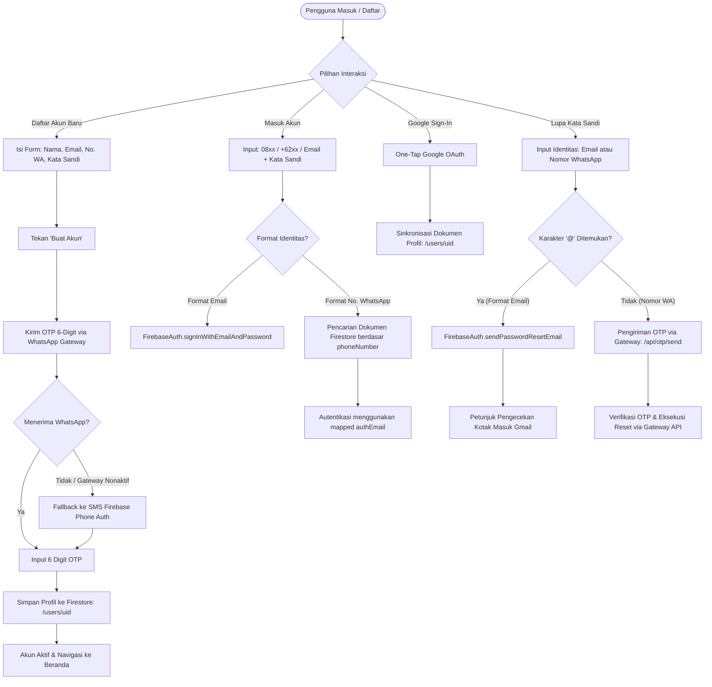

# RideOn — Platform On-Demand Transport & Merchant (Monorepo)

[](https://flutter.dev/)
[](https://dart.dev/)
[](https://nodejs.org/)
[](https://firebase.google.com/)
[]()
[]()
[]()

RideOn adalah platform terintegrasi untuk layanan transportasi on-demand, pesan antar makanan (*food delivery*), dan pengiriman barang/titip belanja (*courier and shopping service*) berbasis monorepo. Sistem ini menggabungkan tiga aplikasi klien mobile/web berbasis Flutter, layanan microservice terpusat untuk komunikasi (*WhatsApp Gateway and SMTP Relay*), basis data terdistribusi (*Cloud Firestore and Firebase Realtime Database*), serta integrasi komputasi awan yang dapat diskalakan ke *Oracle Cloud Infrastructure* (OCI).

---

## Daftar Isi

1. [Ringkasan Eksekutif dan Layanan Utama](#1-ringkasan-eksekutif-dan-layanan-utama)
2. [Susunan Tim Perancang dan Pengembang](#2-susunan-tim-perancang-dan-pengembang)
3. [Arsitektur Monorepo dan Struktur Direktori](#3-arsitektur-monorepo-dan-struktur-direktori)
4. [Spesifikasi Aplikasi Klien](#4-spesifikasi-aplikasi-klien)
   - [Customer App (`apps/customer_app`)](#41-customer-app-appscustomer_app)
   - [Driver App (`apps/driver_app`)](#42-driver-app-appsdriver_app)
   - [Page Toko / Merchant (`apps/page_toko`)](#43-page-toko--merchant-appspage_toko)
5. [Layanan Backend Bersama (`services/wa-gateway`)](#5-layanan-backend-bersama-serviceswa-gateway)
6. [Subsistem Autentikasi dan Keamanan](#6-subsistem-autentikasi-dan-keamanan)
7. [Arsitektur Pemetaan dan Geolocation](#7-arsitektur-pemetaan-dan-geolocation)
8. [Desain Basis Data dan Skema Koleksi](#8-desain-basis-data-dan-skema-koleksi)
9. [Design System dan Taksonomi Aset](#9-design-system-dan-taksonomi-aset)
10. [Indeks Dokumentasi Teknis Sistem](#10-indeks-dokumentasi-teknis-sistem)
11. [Persyaratan Sistem dan Lingkungan Pengembangan](#11-persyaratan-sistem-dan-lingkungan-pengembangan)
12. [Panduan Instalasi dan Eksekusi](#12-panduan-instalasi-dan-eksekusi)
13. [Prosedur Operasional Standar Serah Terima Tim](#13-prosedur-operasional-standar-serah-terima-tim)
14. [Pengujian Otomatis dan Standar Mutu Kode](#14-pengujian-otomatis-dan-standar-mutu-kode)
15. [Panduan Pemecahan Masalah](#15-panduan-pemecahan-masalah)
16. [Rencana Pengembangan Sistem](#16-rencana-pengembangan-sistem)

---

## 1. Ringkasan Eksekutif dan Layanan Utama

RideOn dirancang untuk memfasilitasi kebutuhan mobilitas, logistik, dan transaksi komersial lokal melalui tiga pilar layanan terpadu:

```
+-------------------------------------------------------------------------+
|                           EKOSISTEM RIDEON                              |
+-------------------+-----------------------------+-----------------------+
|     FlexRide      |          FlexFood           |       FlexSend        |
|  Transportasi     |    Pesan Antar Makanan      | Titip Belanja & Kirim |
+-------------------+-----------------------------+-----------------------+
| Customer <->      | Customer <-> Toko <->       | Customer <-> Driver   |
| Driver            | Driver                      | <-> Toko (Talangan)   |
| Sepeda Motor      | Multi-item, catatan khusus, | Multi-toko, estimasi  |
| dan Mobil         | pelacakan pesanan live      | kas, pelacakan rute   |
+-------------------+-----------------------------+-----------------------+
```

### Karakteristik Kunci Platform:
* **Single Identity Pool**: Menggunakan satu project Firebase Authentication (`rideon-9eb77`) dengan kontrol akses berbasis peran (*Role-Based Access Control*) pada Cloud Firestore.
* **Smart Login**: Autentikasi fleksibel mendukung nomor WhatsApp (format `08xx` atau `+62xx`), alamat email, dan integrasi Google Sign-In sekali sentuh.
* **WhatsApp Gateway Mandiri**: Engine WhatsApp Web Headless berbasis Baileys untuk pengiriman OTP pendaftaran, verifikasi perubahan nomor, dan pemulihan kata sandi tanpa biaya SMS.
* **Mekanisme Fallback Otomatis**: Integrasi otomatis ke Firebase Phone Auth SMS apabila jaringan WhatsApp Gateway tidak dapat dijangkau.
* **Two-Tier Map Infrastructure**: Dukungan penuh OpenStreetMap gratis pada tahap pengembangan dan ketersediaan jalur migrasi ke Google Maps Platform untuk tahap produksi.

---

## 2. Susunan Tim Perancang dan Pengembang

Proyek platform RideOn dirancang dan dikembangkan oleh tim lintas disiplin berikut:

| Nama Pengembang | Peran dan Tanggung Jawab Teknis | Cakupan Kerja Utama |
| :--- | :--- | :--- |
| **Joni Utama** | Mobile Application Engineer (Programmer) | Pengembangan modul mobile klien, integrasi logika bisnis, dan state management aplikasi. |
| **Muhammad Taufiq** | Mobile Application Engineer (Programmer) | Rekayasa fitur antarmuka mobile, integrasi layanan autentikasi, serta pengujian fungsional modul. |
| **Fikri Haykal Rananta Sinulingga** | Mobile Application Engineer (Programmer) | Arsitektur data mobile, konektivitas database real-time, sinkronisasi posisi radar, dan integrasi background services. |
| **Muhammad Luthfi Fadil** | Frontend Web Architect & Admin Dashboard Specialist | Perancangan arsitektur web dashboard, perancangan sistem kontrol terpusat, analitik platform, dan panel verifikasi mitra. |
| **Ghufran Fadlurrahman** | Lead Product & UI/UX Designer | Perancangan antarmuka pengguna (UI), riset pengalaman pengguna (UX), standarisasi design system token, dan penyusunan aset visual Figma. |

---

## 3. Arsitektur Monorepo dan Struktur Direktori

Repositori RideOn menggunakan struktur monorepo untuk menyatukan seluruh aplikasi klien, microservice, dan dokumentasi sistem:

```text
RideOn/
├── apps/                               # Klien Antarmuka (Flutter Mobile & Web)
│   ├── customer_app/                   # Klien Mobile Pelanggan (Clean Architecture)
│   ├── driver_app/                     # Klien Mobile Mitra Pengemudi (Radar & Saldo)
│   └── page_toko/                      # Klien Web/Mobile Mitra Toko (Katalog & Order)
│
├── services/                           # Backend Microservices Bersama
│   └── wa-gateway/                     # Layanan Terpusat WhatsApp Gateway (Node.js Baileys)
│       ├── storage/sessions/           # Penyimpanan sesi terenkripsi WhatsApp Multi-Device
│       ├── db-auth.js                  # Penanganan status autentikasi Baileys
│       ├── server.js                   # REST API Express dan webhook dispatcher
│       └── package.json
│
├── packages/                           # Shared Packages (Model Data & Utilitas Bersama)
│
├── docs/                               # Dokumentasi Resmi Sistem (Single Source of Truth)
│   ├── 01-system-architecture.md       # Arsitektur sistem menyeluruh dan alur interaksi
│   ├── 02-database-design.md           # Skema 20 koleksi Firestore, RTDB, dan Security Rules
│   ├── 03-firebase-library-checklist.md# Matriks dependensi dan checklist integrasi Firebase
│   ├── 04-authentication-guide.md      # Panduan autentikasi dan sinkronisasi multi-role
│   ├── 05-project-worklog-and-handover.md # Log pengerjaan dan panduan serah terima tim
│   ├── 06-auth-registration-otp-revision.md # Revisi pendaftaran dan spesifikasi OTP WhatsApp
│   ├── 07-whatsapp-gateway-and-otp-architecture.md # Arsitektur gateway Baileys dan fallback SMS
│   ├── 08-firebase-phone-auth-sms-setup.md # Konfigurasi Phone Auth SMS Indonesia (+62)
│   ├── 09-profile-photo-storage-and-oracle-cloud-migration.md # Kompresi Base64 vs OCI Storage
│   ├── 10-auth-security-and-password-management.md # Verifikasi email dan alur lupa kata sandi
│   ├── 11-map-provider-architecture-and-google-maps-migration.md # OpenStreetMap vs Google Maps
│   ├── 12-customer-app-master-guide-auth-settings-and-services.md # Dokumentasi master Customer App
│   ├── 13-email-otp-smtp-setup-guide.md # Panduan aktivasi Email OTP via Gmail SMTP
│   └── 14-assets-migration-and-taxonomy-guide.md # Taksonomi dan pemetaan 91 aset Figma
│
├── .env.example                        # Template environment global
├── .gitignore                          # Konfigurasi pengabaian berkas rahasia & build
├── google-services.json.example        # Acuan format kredensial multi-aplikasi Firebase
├── start_emulator.bat                  # Script batch otomasi emulator Android
└── README.md                           # Dokumentasi komprehensif monorepo (berkas ini)
```

---

## 4. Spesifikasi Aplikasi Klien

### 4.1 Customer App (`apps/customer_app`)
* **Package ID / Namespace**: `com.rideon.customer`
* **Pola Desain**: Feature-First Clean Architecture (`core/` dan `features/`)
* **Metrik Pengujian**: 44 dari 44 Widget dan Unit Test berstatus lulus (100%), 0 isu linter.

#### Modul Fungsional:
1. **Core Subsystem**:
   - `core/constants/app_colors.dart`: Palet warna desain resmi.
   - `core/models/country_code.dart`: Sentralisasi selektor kode negara (12 negara).
   - `core/utils/phone_number_formatter.dart`: Pemformat nomor telepon dan eliminasi karakter awal `0`.
   - `core/widgets/user_avatar.dart`: Komponen avatar polimorfik (Base64, Network URL, File lokal).
2. **Features**:
   - `splash`: Layar pembuka dan penentuan routing berdasarkan status sesi.
   - `auth`: Login multi-format, registrasi multi-step dengan validasi OTP, pemulihan sandi.
   - `home`: Beranda utama, 3 kartu layanan (FlexRide, FlexFood, FlexSend), banner promosi, alamat favorit.
   - `flexride`: Pemesanan motor/mobil, penentuan titik jemput, catatan driver, pelacakan live.
   - `flexfood`: Pencarian merchant, pemilihan katalog menu, keranjang belanja, checkout order.
   - `flexsend`: Titip belanja multi-lokasi, kalkulasi estimasi dana talangan pengemudi.
   - `chat`: Komunikasi pesan instan dan panggilan suara dengan pengemudi.
   - `aktivitas`: Riwayat transaksi aktif, riwayat transaksi selesai, fitur pemesanan ulang.
   - `favorit`: Bookmark toko dan menu favorit pelanggan.
   - `pengaturan`: Pengaturan profil, crop foto lingkaran 512x512, pembaruan nomor WhatsApp, verifikasi email resmi Google, pembaruan kata sandi, dan peta titik simpan alamat.

### 4.2 Driver App (`apps/driver_app`)
* **Package ID / Namespace**: `com.rideon.driver`
* **Fokus Operasional**:
  - **Radar Real-Time**: Visualisasi posisi live pengemudi dengan status ketersediaan (*driver presence*).
  - **Penerimaan Pesanan Masuk**:
    - **FlexRide**: Countdown 16 detik, estimasi jarak tempuh, ongkos, titik jemput dan antar.
    - **FlexFood**: Rincian merchant, item makanan, pendapatan bersih.
    - **FlexSend**: Estimasi kebutuhan modal kas talangan belanja.
  - **Dompet Mitra (`wallet`)**: Informasi saldo aktif, rekapitulasi mutasi dana, penarikan saldo ke bank.
  - **Aktivitas (`activity`)**: Rekap riwayat perjalanan pengantaran yang telah diselesaikan.
  - **Chat dan Panggilan**: Saluran komunikasi langsung dengan pelanggan selama pesanan aktif.
  - **Registrasi 9 Tahap**: Validasi dokumen fisik mitra (KTP, SIM, STNK, SKCK, foto kendaraan).
  - **DriverService**: Pengiriman koordinat GPS berkala (3-5 detik) ke node Realtime Database `/driver_locations/{driverId}`.

### 4.3 Page Toko / Merchant (`apps/page_toko`)
* **Package ID / Namespace**: `com.rideon.page_toko`
* **Platform Target**: Android dan Web Browser (Flutter Web)
* **Fokus Operasional**:
  - **Tab 1: Home**: Kontrol status buka/tutup toko, ringkasan omzet hari berjalan, pemantau order langsung.
  - **Tab 2: Pesanan (`orders`)**: Siklus hidup pesanan (`Baru` -> `Dimasak` -> `Siap Diambil Kurir` -> `Selesai/Batal`).
  - **Tab 3: Menu (`menu`)**: Pengelolaan katalog menu, pengaturan ketersediaan stok, penambahan produk baru.
  - **Tab 4: Keuangan (`finance`)**: Saldo toko, riwayat transaksi masuk/keluar, rekening penarikan dana.
  - **Tab 5: Toko (`profile`)**: Profil bisnis, jam operasional mingguan, koordinat pinpoint lokasi toko.

---

## 5. Layanan Backend Bersama (`services/wa-gateway`)

Layanan terpusat di `services/wa-gateway` bertindak sebagai backend headless WhatsApp berbasis pustaka `@whiskeysockets/baileys` yang beroperasi pada port `3000`. Layanan ini menangani kebutuhan notifikasi dan verifikasi seluruh klien monorepo.

### Kapabilitas Teknis:
1. **Multi-Device Session Persistence**: Sesi autentikasi disimpan pada `storage/sessions/` sehingga server tetap terhubung setelah proses *restart*.
2. **Antarmuka Pemindaian QR**: Halaman web mandiri pada rute `/qr` untuk kemudahan menghubungkan nomor resmi.
3. **Dual Dispatcher (WhatsApp dan Email)**: Mendukung pengiriman kode OTP melalui WhatsApp dan email (Nodemailer via Gmail SMTP).
4. **Firebase Admin SDK**: Eksekusi perubahan kredensial akun pengguna secara langsung melalui backend API.
5. **Telegram Watchdog**: Notifikasi peringatan ke admin apabila sesi WhatsApp terputus.

### Matriks Endpoint REST API:

| HTTP Method | Endpoint | Otorisasi | Deskripsi dan Payload |
| :--- | :--- | :--- | :--- |
| `GET` | `/health` | Publik | Pengecekan status server dan uptime. |
| `GET` | `/status` | Publik | Pengecekan status koneksi WhatsApp dan nomor aktif. |
| `GET` | `/qr` | Publik | Tampilan antarmuka HTML untuk pemindaian QR code. |
| `POST` | `/api/otp/send` | Publik | Pembuatan dan pengiriman OTP 6 digit ke nomor WhatsApp.<br>Payload: `{"phone": "6285323441080", "purpose": "register"}` |
| `POST` | `/api/otp/verify` | Publik | Validasi 6 digit kode OTP.<br>Payload: `{"phone": "6285323441080", "otp": "123456"}` |
| `POST` | `/api/auth/reset-password` | Publik | Pembaruan kata sandi pengguna melalui Firebase Admin.<br>Payload: `{"phone": "6285323441080", "newPassword": "passwordBaru123"}` |
| `POST` | `/api/email/otp/send` | Publik | Pengiriman OTP 6 digit via SMTP Gmail.<br>Payload: `{"email": "user@gmail.com"}` |
| `POST` | `/api/email/otp/verify` | Publik | Validasi OTP email.<br>Payload: `{"email": "user@gmail.com", "otp": "654321"}` |
| `POST` | `/send` | Header `x-gateway-key` | Pengiriman pesan WhatsApp umum (notifikasi pesanan).<br>Payload: `{"phone": "628...", "message": "Pesan sistem"}` |
| `POST` | `/logout` | Header `x-gateway-key` | Pemutusan sesi WhatsApp dan pembersihan direktori sesi lokal. |
| `POST` | `/restart` | Header `x-gateway-key` | Inisialisasi ulang koneksi socket WhatsApp secara terprogram. |

---

## 6. Subsistem Autentikasi dan Keamanan



### Standar Keamanan Data Pengguna:
* **Penyimpanan Foto Profil Efisien (Solusi A)**:
  * Dimensi kompresi retina `512x512` piksel, format JPEG dengan kualitas kompresi 75% (< 35 KB).
  * Data disimpan dalam format Base64 pada dokumen Firestore `/users/{uid}` kolom `photoUrl`.
  * Menghilangkan ketergantungan biaya bucket Cloud Storage pada tahap awal pengembangan.
  * Jalur migrasi ke *Oracle Cloud Infrastructure (OCI) Object Storage* telah didokumentasikan di [docs/09-profile-photo-storage-and-oracle-cloud-migration.md](docs/09-profile-photo-storage-and-oracle-cloud-migration.md).
* **Verifikasi Email Mandiri**:
  * Menggunakan sistem *out-of-band verification* Google Firebase (`verifyBeforeUpdateEmail`) atau transmisi OTP via Gmail SMTP Relay.
  * Menerapkan prinsip *Zero Premature Firestore Write*: basis data tidak akan diperbarui sebelum kepemilikan email diverifikasi secara faktual.

---

## 7. Arsitektur Pemetaan dan Geolocation

Platform mengimplementasikan arsitektur pemetaan dua tahap (*two-tier map strategy*):

```
+-------------------------------------------------------------------------+
|                      STRATEGI PEMETAAN RIDEON                           |
+------------------------------------+------------------------------------+
|    Fase 1: OpenStreetMap (Aktif)   |   Fase 2: Google Maps (Produksi)   |
+------------------------------------+------------------------------------+
| * Modul: flutter_map + latlong2    | * Modul: google_maps_flutter       |
| * Sensor: geolocator               | * Menggunakan alokasi $200 USD/bln |
| * Reverse Geocoding: geocoding     | * Billing via Visa Bank Jago       |
| * Lisensi: 100% Gratis Selamanya   | * Navigasi turn-by-turn dan rute   |
| * Implementasi: LokasiAndaScreen   |   jalan gang sempit presisi        |
+------------------------------------+------------------------------------+
```

### Kemampuan Layar `LokasiAndaScreen`:
1. **Interactive Floating Center Pin**: Pengguna dapat menggeser peta secara dinamis untuk menentukan titik lokasi penjemputan/pengantaran.
2. **Automated Reverse Geocoding**: Alamat jalan, kelurahan, dan kecamatan diperbarui secara otomatis saat pergeseran peta berakhir (`MapEventMoveEnd`).
3. **Multi-Label Saved Places**: Penyimpanan alamat favorit dengan label kategori (`[Rumah]`, `[Kantor]`, `[Kost]`, `[Lainnya]`) beserta catatan detail patokan penjemputan.

---

## 8. Desain Basis Data dan Skema Koleksi

Sistem basis data terdistribusi pada dua region Firebase:
* **Cloud Firestore** (`asia-southeast2` Jakarta): Penyimpanan data transaksional, profil aktor, konfigurasi, dan katalog menu.
* **Firebase Realtime Database** (`asia-southeast1` Singapore): Komunikasi berlatensi rendah untuk koordinat GPS radar driver, status presensi, dan pesan chat.

### Peta 20 Koleksi Cloud Firestore:

```text
firestore-root/
├── users/                    # Profil seluruh aktor (customer, driver, pemilik toko)
├── driverProfiles/           # Spesifikasi armada, dokumen verifikasi, data rating
├── storeProfiles/            # Profil usaha resto, jam operasional, status toko
├── orders/                   # Master data seluruh transaksi pemesanan
│   └── {orderId}/items/      # Sub-koleksi rincian barang/menu transaksi
├── menuItems/                # Katalog menu dan item produk resto mitra
├── transactions/             # Pencatatan mutasi saldo dompet driver dan toko
├── wallets/                  # Saldo terkini dan status dompet virtual
├── bankAccounts/             # Data rekening perbankan untuk pencairan dana
├── withdrawals/              # Antrean permohonan penarikan dana ke rekening
├── ratings/                  # Ulasan bintang dan evaluasi kualitas transaksi
├── promotions/               # Master voucher potongan harga dan diskon ongkir
├── referrals/                # Pencatatan rujukan kode referral pengguna
├── favorites/                # Daftar merchant dan menu yang disimpan pengguna
├── pricingRules/             # Aturan tarif dasar dan tarif per kilometer
├── surgeZones/               # Parameter tarif dinamis pada zona dan jam sibuk
├── verificationRequests/     # Antrean validasi berkas dokumen mitra oleh admin
├── disputes/                 # Pelaporan sengketa transaksi dan klaim dana
├── notifications/            # Log riwayat notifikasi Firebase Cloud Messaging
├── appConfig/                # Konfigurasi runtime sistem (versi minimal, status maintenance)
└── driverLevels/             # Definisi tingkatan performa driver (Bronze, Silver, Gold)
```

### Siklus Status Pesanan (*Order State Machine*):
```
[PLACED] ---> [ACCEPTED] ---> [COOKING / SHOPPING] ---> [READY_FOR_PICKUP]
                 |
                 v
[CANCELLED]   [ON_THE_WAY] ---> [ARRIVED] ---> [COMPLETED]
```

---

## 9. Design System dan Taksonomi Aset

### Token Warna Resmi:

| Token Desain | Nilai Hex | Peruntukan Antarmuka |
| :--- | :--- | :--- |
| **Primary Purple** | `#6B48FC` | Warna utama platform, tombol aksi primer (CTA), bar navigasi aktif. |
| **Pale Purple** | `#C6BCFF` | Latar kartu menu, batas kontainer lembut, panel sekunder. |
| **Dark Navy / Ink**| `#17152B` | Tipografi teks utama, kontras latar belakang, tombol mode gelap. |
| **Success Green**  | `#16A34A` | Status online pengemudi, indikator verifikasi berhasil, penanda jemput. |
| **Error Red**      | `#E11D48` | Peringatan validasi, status pembatalan, mutasi debit saldo. |
| **Warning Gold**   | `#FFB800` | Zona padat pemesanan (heatmap), bintang ulasan, banner promo. |
| **Splash Gradient**| `#6B48FC` -> `#C6BCFF` | Latar kartu header profil dan elemen grafis pembuka. |

### Taksonomi Aset Visual (`apps/customer_app/assets-2/`):
Seluruh 91 file aset dari desain Figma dikelompokkan dalam hierarki 2 tingkat terstruktur:
* `icons/navbar/`: Ikon navigasi bawah (status normal dan status aktif).
* `icons/home/`: Ikon header seksi promo, wisata, dan kupon diskon.
* `icons/auth/`: Ikon Google OAuth, gembok sandi, toggle mata sandi, perisai keamanan.
* `icons/settings/`: Ikon menu pengaturan profil, nomor WhatsApp, email, dan alamat.
* `icons/theme/`: Aset modal tema gelap (`dark/`) dan tema terang (`light/`).
* `icons/places/`: Penanda lokasi rumah, kantor, kost, pusat perbelanjaan, dan pin GPS.
* `icons/actions/`: Tombol panggilan telepon, mikrofon, kamera, crop, dan galeri.
* `images/services/`: Ilustrasi layanan FlexRide, FlexFood, FlexSend, Motor, dan Mobil.
* `images/food/`: Foto katalog menu beresolusi tinggi (kebab, rendang, bakso, dll).
* `images/banners/`: Banner promosi beranda dan spanduk penawaran.
* `images/illustrations/`: Ilustrasi interaksi pengguna dan status transaksi.

---

## 10. Indeks Dokumentasi Teknis Sistem

Folder `docs/` memuat dokumentasi mendalam sebagai rujukan teknis utama:

| Nomor | Dokumen | Rangkuman Isi dan Spesifikasi |
| :---: | :--- | :--- |
| **01** | [01-system-architecture.md](docs/01-system-architecture.md) | Blueprint arsitektur platform, flow FlexRide/Food/Send, dan ADR keputusan sistem. |
| **02** | [02-database-design.md](docs/02-database-design.md) | Detail 20 koleksi Firestore, Realtime Database, Cloud Functions, dan aturan keamanan. |
| **03** | [03-firebase-library-checklist.md](docs/03-firebase-library-checklist.md) | Matriks library Firebase lintas aplikasi dan panduan mitigasi kendala dependensi. |
| **04** | [04-authentication-guide.md](docs/04-authentication-guide.md) | Alur autentikasi Google Sign-In, Email/Password, dan sinkronisasi profil multi-peran. |
| **05** | [05-project-worklog-and-handover.md](docs/05-project-worklog-and-handover.md) | Log riwayat pengembangan, pembagian tanggung jawab modul, dan SOP serah terima tim. |
| **06** | [06-auth-registration-otp-revision.md](docs/06-auth-registration-otp-revision.md) | Spesifikasi revisi antarmuka registrasi, verifikasi WhatsApp OTP, dan modal dialog. |
| **07** | [07-whatsapp-gateway-and-otp-architecture.md](docs/07-whatsapp-gateway-and-otp-architecture.md) | Arsitektur WhatsApp Gateway Baileys di root monorepo, rate limit, dan fallback SMS. |
| **08** | [08-firebase-phone-auth-sms-setup.md](docs/08-firebase-phone-auth-sms-setup.md) | Konfigurasi Phone Auth SMS, pendaftaran fingerprint SHA-256, dan SMS Region Policy ID. |
| **09** | [09-profile-photo-storage-and-oracle-cloud-migration.md](docs/09-profile-photo-storage-and-oracle-cloud-migration.md) | Arsitektur Base64 Firestore dan SOP migrasi berkas ke Oracle Cloud Object Storage (OCI). |
| **10** | [10-auth-security-and-password-management.md](docs/10-auth-security-and-password-management.md) | Verifikasi email resmi Google, re-autentikasi ganti sandi, dan lupa sandi dual-route. |
| **11** | [11-map-provider-architecture-and-google-maps-migration.md](docs/11-map-provider-architecture-and-google-maps-migration.md) | Arsitektur peta OpenStreetMap gratis dan SOP migrasi ke Google Maps Platform via Bank Jago. |
| **12** | [12-customer-app-master-guide-auth-settings-and-services.md](docs/12-customer-app-master-guide-auth-settings-and-services.md) | Dokumentasi master Customer App: rincian layar Auth, Pengaturan Akun, dan integrasi services. |
| **13** | [13-email-otp-smtp-setup-guide.md](docs/13-email-otp-smtp-setup-guide.md) | Panduan aktivasi pengiriman OTP email tanpa biaya via Google App Password dan Gmail SMTP. |
| **14** | [14-assets-migration-and-taxonomy-guide.md](docs/14-assets-migration-and-taxonomy-guide.md) | Kamus pemetaan 1-ke-1 dari 91 aset Figma ke struktur folder `assets-2/`. |

---

## 11. Persyaratan Sistem dan Lingkungan Pengembangan

Pastikan lingkungan komputer pengembang memenuhi spesifikasi minimal berikut:

* **Flutter SDK**: Versi `^3.13.5` hingga `3.24.x` (Channel Stable).
* **Dart SDK**: Versi `^3.3.0`.
* **Node.js**: Versi `>= 18.0.0` (Direkomendasikan Node.js 20 LTS) dan NPM `>= 9.0.0`.
* **Java Development Kit (JDK)**: OpenJDK 17 atau OpenJDK 21 (untuk proses kompilasi Android Gradle).
* **Android SDK**: API Level 34 (Android 14) dengan Min SDK versi 21.
* **Git**: Versi `>= 2.30.0`.
* **Firebase CLI**: Versi `>= 13.0.0` (`npm install -g firebase-tools`).

---

## 12. Panduan Instalasi dan Eksekusi

### Langkah 1: Kloning Repositori
```bash
git clone https://github.com/username/RideOn.git
cd RideOn
```

### Langkah 2: Konfigurasi Kredensial Lingkungan Lokal
Salin template konfigurasi ke berkas `.env` lokal pada masing-masing sub-proyek:
```bash
# Customer App
cp apps/customer_app/.env.example apps/customer_app/.env

# Driver App
cp apps/driver_app/.env.example apps/driver_app/.env

# Page Toko
cp apps/page_toko/.env.example apps/page_toko/.env

# WhatsApp Gateway Service
cp services/wa-gateway/.env.example services/wa-gateway/.env
```

Pastikan berkas resmi `google-services.json` diletakkan pada:
* `apps/customer_app/android/app/google-services.json`
* `apps/driver_app/android/app/google-services.json`
* `apps/page_toko/android/app/google-services.json`

### Langkah 3: Menjalankan WhatsApp Gateway Microservice
```bash
cd services/wa-gateway
npm install
npm start
```
* Buka browser pada alamat: `http://localhost:3000/qr`
* Buka WhatsApp pada smartphone pengembang -> **Perangkat Tertaut** -> **Tautkan Perangkat** -> Pindai QR code pada layar.
* Status akan diperbarui menjadi **WhatsApp Terhubung**.

> [!NOTE]
> **Penting untuk Pengujian pada Perangkat Android Fisik via USB Debugging:**
> Agar perangkat fisik dapat mengakses server gateway laptop di alamat `localhost:3000`, jalankan perintah port forwarding adb:
> ```bash
> adb reverse tcp:3000 tcp:3000
> ```

### Langkah 4: Menjalankan Aplikasi Mobile Pelanggan (Customer App)
```bash
cd apps/customer_app
flutter pub get
flutter run
```

### Langkah 5: Menjalankan Aplikasi Mobile Pengemudi (Driver App)
```bash
cd apps/driver_app
flutter pub get
flutter run
```

### Langkah 6: Menjalankan Aplikasi Mitra Toko (Page Toko)
```bash
cd apps/page_toko
flutter pub get

# Untuk eksekusi pada Android:
flutter run

# Untuk eksekusi pada Web Browser:
flutter run -d chrome
```

---

## 13. Prosedur Operasional Standar Serah Terima Tim

Untuk mencegah kendala kompilasi atau kegagalan autentikasi pada perangkat pengembang baru:

### 1. Pendaftaran Sertifikat Digital SHA-1 dan SHA-256:
Untuk mengatasi kegagalan Google Sign-In (*Error Code 10*), ekstrak nilai hash sertifikat debug komputer lokal Anda:
```bash
cd apps/customer_app/android

# Pengguna Windows PowerShell:
.\gradlew.bat signingReport

# Pengguna Linux / macOS:
./gradlew signingReport
```
Salin nilai **SHA1** dan **SHA-256** dari blok `Variant: debug`, kemudian daftarkan ke **Firebase Console > Project Settings > Your Apps > Add Fingerprint** untuk ketiga aplikasi (`com.rideon.customer`, `com.rideon.driver`, `com.rideon.page_toko`).

### 2. Konfigurasi Kebijakan Wilayah SMS (SMS Region Policy):
1. Buka [Firebase Console](https://console.firebase.google.com/project/rideon-9eb77/authentication/settings).
2. Buka menu **Authentication** -> tab **Settings** -> pilih **SMS region policy**.
3. Pastikan wilayah **Indonesia (+62)** telah ditambahkan ke dalam daftar yang diizinkan (*Allowlist*).

### 3. Akun Pengujian Bebas Kuota:
Gunakan nomor pengujian terdaftar untuk pengujian instan tanpa konsumsi kuota SMS pada **Authentication > Settings > Phone numbers for testing**:
* **Nomor Pengujian**: `+6285323441080`
* **Kode OTP Standar**: `123456`

---

## 14. Pengujian Otomatis dan Standar Mutu Kode

Seluruh komponen telah dilengkapi dengan pengujian unit dan pengujian widget otomatis untuk menjamin stabilitas fungsional sistem.

### Eksekusi Seluruh Test Suite pada Customer App:
```bash
cd apps/customer_app

# Menjalankan 44 pengujian widget dan pengujian unit
flutter test

# Menjalankan analisis statis dan linter
flutter analyze
```

### Cakupan Berkas Pengujian:
* `test/pengaturan_akun_test.dart`: 26 pengujian (Ubah profil, ganti no WA, verifikasi email, ganti kata sandi, modal keluar akun).
* `test/login_screen_test.dart`: 6 pengujian (Validasi email, no WA, toggle sandi, navigasi pemulihan).
* `test/lokasi_anda_screen_test.dart`: Pengujian interaktivitas canvas peta OSM dan reverse geocoding.
* `test/email_otp_test.dart`: Pengujian input 6 kotak OTP email dan penghitungan mundur 60 detik.
* `test/chat_flexride_aktivitas_test.dart`: Pengujian integrasi pemesanan ojek dan obrolan pesan instan.
* `test/flexfood_flexsend_test.dart`: Pengujian alur checkout pesanan makanan dan estimasi belanjaan.

---

## 15. Panduan Pemecahan Masalah

### 1. Google Sign-In Mengembalikan Error Code 10 atau 12500
* **Penyebab**: Hash SHA-1 atau SHA-256 dari debug keystore komputer lokal belum didaftarkan di Firebase Console, atau file `google-services.json` belum diperbarui setelah penambahan fingerprint.
* **Solusi**: Jalankan `.\gradlew.bat signingReport` di folder `android/`, tambahkan hash ke Firebase Console, unduh ulang `google-services.json`, dan pasang pada folder `android/app/`.

### 2. Perangkat Android Fisik Tidak Dapat Menerima OTP dari WhatsApp Gateway
* **Penyebab**: Perangkat Android fisik memperlakukan alamat `localhost` sebagai perangkat itu sendiri.
* **Solusi**: Hubungkan perangkat via kabel data dengan mode USB Debugging aktif, lalu jalankan:
  ```bash
  adb reverse tcp:3000 tcp:3000
  ```
  Pastikan status koneksi pada `http://localhost:3000/status` menunjukkan status terkoneksi.

### 3. Pesan Kesalahan Firebase Phone Auth: Code 17006
* **Penyebab**: Pengiriman SMS diblokir oleh filter keamanan wilayah Firebase.
* **Solusi**: Masuk ke Firebase Console -> Authentication -> Settings -> SMS Region Policy -> Tambahkan Indonesia (+62) ke dalam daftar Allowlist.

### 4. Galat Port Bentrok (EADDRINUSE 3000) pada WhatsApp Gateway
* **Penyebab**: Proses server Node.js sebelumnya masih berjalan di latar belakang.
* **Solusi**:
  * Windows PowerShell: `Get-Process -Name node | Stop-Process -Force`
  * Linux / macOS: `npx kill-port 3000`
  * Kemudian jalankan ulang `npm start` di folder `services/wa-gateway`.

---

## 16. Rencana Pengembangan Sistem

* **Fase 1: Fondasi Monorepo dan Sistem Autentikasi Terpadu** (Selesai)
  - Penyelarasan package ID: `com.rideon.customer`, `com.rideon.driver`, `com.rideon.page_toko`.
  - Integrasi WhatsApp Gateway (Baileys) dengan fallback otomatis ke SMS Firebase Phone Auth.
  - Modul Pengaturan Akun, crop foto profil Base64, ganti nomor WhatsApp, Email OTP, dan peta OSM.
* **Fase 2: Integrasi Driver App dan Merchant Toko** (Dalam Proses)
  - Sinkronisasi radar pengemudi ke Realtime Database (`driver_locations`).
  - Listener pesanan real-time pada Page Toko (`orders` collection).
  - Alur transaksi saldo dan penarikan dana mitra.
* **Fase 3: Integrasi Gerbang Pembayaran dan Notifikasi Push**
  - Implementasi Payment Gateway (Midtrans / Xendit Sandbox).
  - Pengiriman notifikasi latar belakang menggunakan Firebase Cloud Messaging (FCM).
* **Fase 4: Migrasi Skala Enterprise dan Peluncuran Produksi**
  - Migrasi media profil dan dokumen verifikasi ke Oracle Cloud Infrastructure (OCI) Object Storage.
  - Implementasi pemrosesan komputasi geospasial menggunakan Oracle Cloud Functions.
  - Penerbitan Admin Dashboard terpusat berbasis Next.js pada Firebase Hosting.

---

Hak Cipta (c) 2026 RideOn Platform. Seluruh hak cipta dilindungi undang-undang.
Dokumentasi ini disusun untuk standarisasi teknis pengembangan monorepo RideOn.
