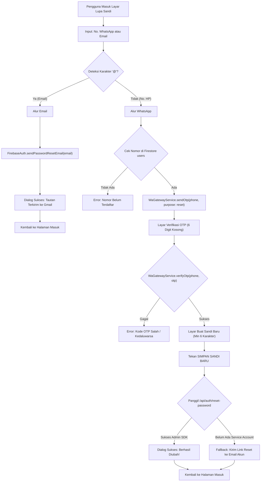

# 10 - Panduan Arsitektur Autentikasi, Keamanan Akun & Pemulihan Kata Sandi

> **Status:** Active & Production Ready  
> **Modul:** Customer App (`apps/customer_app`) & WhatsApp Gateway (`services/wa-gateway`)  
> **Target:** `com.rideon.customer` | Firebase Project: `rideon-9eb77`  
> **Terakhir Diperbarui:** 30 Oktober 2026

---

## 📌 Ringkasan Eksekutif

Dokumen ini mendokumentasikan pembaruan menyeluruh pada subsistem autentikasi dan pengaturan akun Customer App RideOn, yang mencakup:
1. **Verifikasi Alamat Email Resmi Google Firebase** (beralih dari OTP WhatsApp ke link verifikasi Gmail).
2. **Fitur Keamanan Akun & Ganti Kata Sandi** (`KeamananAkunScreen`) dengan re-autentikasi deterministik.
3. **Revamp Menyeluruh Alur Lupa Kata Sandi** (`ForgotPasswordScreen`) dengan dukungan ganda (*Dual Identifier*: Email & WhatsApp OTP nyata).
4. **Peningkatan WhatsApp Gateway Service** dengan penambahan endpoint `/api/auth/reset-password` berbasis Firebase Admin SDK.
5. **Spesifikasi & Verifikasi Smart Login** (login fleksibel menggunakan format `08xx`, `+62xx`, atau Email).

---

## 📧 1. Verifikasi Alamat Email Resmi Google Firebase (`AlamatEmailScreen`)

### A. Latar Belakang & Perubahan Arsitektur
Sebelumnya, penambahan atau perubahan alamat email diverifikasi melalui kode OTP yang dikirimkan ke WhatsApp. Namun, untuk memastikan keabsahan kepemilikan kotak surat pengguna dan kepatuhan standar keamanan Google, alur dialihkan ke **tautan verifikasi resmi Google Firebase**.

### B. Mekanisme Kerja (*Out-of-Band Email Verification*)
1. **Formulir Adaptif (2 Kolom vs 3 Kolom):**
   - **Mode Hubungkan Email Baru (2 Kolom):** Digunakan jika akun belum memiliki email. Meminta kata sandi akun dan email baru.
   - **Mode Perbarui Email (3 Kolom):** Digunakan jika sudah ada email lama. Meminta kata sandi akun, verifikasi email lama, dan input email baru.
2. **Re-autentikasi Keamanan:**
   Sebelum memicu pengiriman email, akun pengguna di-reautentikasi menggunakan kredensial Firebase:
   ```dart
   final credential = EmailAuthProvider.credential(
     email: authEmail,
     password: password,
   );
   await user.reauthenticateWithCredential(credential);
   ```
3. **Pemicu Tautan Verifikasi:**
   Aplikasi memanggil metode resmi Firebase Authentication:
   ```dart
   await user.verifyBeforeUpdateEmail(newEmail);
   ```
   Google Firebase akan mengirimkan email resmi berisi tautan aman ke kotak masuk Gmail pengguna.
4. **Dialog Konfirmasi & Polling Cerdas (`EmailVerificationDialog`):**
   - Menampilkan modal dialog interaktif dengan animasi pemuatan (*waiting indicator*).
   - **Background Polling:** Menjalankan timer berkala setiap 4 detik untuk memanggil `currentUser.reload()`.
   - **Tombol Aksi Manual:** Tombol **`SAYA SUDAH VERIFIKASI DI GMAIL`** yang mengeksekusi re-autentikasi instan jika sistem web browser lambat menyinkronkan token lokal.
5. **Prinsip *Zero Premature Firestore Write*:**
   Dokumen Cloud Firestore (`/users/{uid}`) **TIDAK AKAN DITULIS ATAU DIUBAH** sampai email benar-benar telah diklik dan status `user.email` di Firebase Auth terverifikasi 100%.

---

## 🔒 2. Fitur Keamanan Akun & Pengubahan Kata Sandi (`KeamananAkunScreen`)

Layar `KeamananAkunScreen` mengimplementasikan desain Figma `keamanan akun.png` dan `ubah sandi success.png`.

### A. Fitur & Validasi UI
* **3 Form Input:**
  1. *Kata Sandi Saat Ini* (Wajib diisi, diverifikasi ke server).
  2. *Kata Sandi Baru* (Minimal 8 karakter, tidak boleh sama dengan sandi lama).
  3. *Konfirmasi Sandi Baru* (Harus sama persis dengan sandi baru).
* **Toggle Mata (*Eye Icon*):** Masing-masing field memiliki toggle independen untuk melihat/menyembunyikan kata sandi.
* **Tautan Pintas:** Tersedia link *"Lupa kata sandi?"* yang langsung mengarahkan ke `ForgotPasswordScreen`.
* **Banner Peringatan Interaktif:** Menampilkan pesan galat berwarna merah (`#E83535`) jika validasi gagal, dan otomatis menghilang begitu pengguna mengetik kembali.

### B. Alur Eksekusi Firebase
1. Mencari identitas login aktif pengguna (`authEmail`) dari profil Firestore atau `user.email`.
2. Melakukan re-autentikasi:
   ```dart
   final cred = EmailAuthProvider.credential(email: authEmail, password: currentPassword);
   await user.reauthenticateWithCredential(cred);
   ```
3. Memperbarui kata sandi:
   ```dart
   await user.updatePassword(newPassword);
   ```
4. Menampilkan modal dialog sukses berlatar *frosted glass*: *"Berhasil Diubah! Kata sandi akun Anda telah berhasil diperbarui."*

---

## 🔑 3. Revamp Menyeluruh Lupa Kata Sandi (`ForgotPasswordScreen`)

### A. Masalah Pada Implementasi Lama (Mockup Statis)
Pada versi awal prototype slicing:
* Kotak OTP 6 digit otomatis terisi angka dummy `1 2 3 4 5 6` saat tombol ditekan.
* Layar selalu menampilkan judul *"Verifikasi WhatsApp"*, bahkan ketika pengguna memasukkan alamat email.
* Tombol simpan hanya memunculkan dialog pop-up tanpa terhubung ke API backend manapun.

### B. Arsitektur Baru: *Dual Identifier Routing*



### C. Rincian Implementasi
1. **Deteksi Otomatis:**
   * Jika mengandung `@`: Tombol otomatis berlabel **`KIRIM TAUTAN RESET KE EMAIL`**.
   * Jika angka telepon: Tombol berlabel **`KIRIM KODE OTP`**.
2. **Integrasi Kotak OTP Interaktif:**
   * Seluruh 6 controller dibersihkan (`c.clear()`).
   * Menggunakan 6 `FocusNode` independen dengan auto-advance maju ke kotak berikutnya saat angka diketik, dan mundur saat tombol backspace ditekan.
   * Auto-submit saat digit ke-6 selesai dimasukkan.
   * Countdown timer 60 detik dengan tombol *Kirim Ulang*.

---

## 📡 4. Pembaruan Layanan Backend WhatsApp Gateway (`services/wa-gateway`)

Untuk mendukung pengaturan ulang kata sandi bagi pengguna yang mendaftar menggunakan nomor telepon, `services/wa-gateway` ditingkatkan:

### A. Template Pesan Dinamis Berdasarkan `purpose`
Pada endpoint `POST /api/otp/send`:
* Jika `purpose == 'reset_password'`:
  > *"RideOn Indonesia 🚗🛵\nHalo! Kode verifikasi untuk mengatur ulang kata sandi akun RideOn Anda adalah: **[CODE]**. Kode ini berlaku selama 5 menit."*
* Jika pendaftaran biasa:
  > *"RideOn Indonesia 🚗🛵\nHalo! Kode verifikasi pendaftaran akun RideOn Anda adalah: **[CODE]**..."*

### B. Endpoint Baru: `POST /api/auth/reset-password`
* Menggunakan paket resmi `firebase-admin`.
* Mencari akun pengguna berdasarkan nomor telepon (`getUserByPhoneNumber` atau query Firestore collection `users`).
* Mengubah kata sandi secara aman di Firebase Authentication:
  ```javascript
  await firebaseAdmin.auth().updateUser(userRecord.uid, {
      password: newPassword
  });
  ```
* Mendukung deteksi otomatis keberadaan file `serviceAccountKey.json`.

---

## 🧠 5. Spesifikasi & Analisis Cara Kerja Smart Login

Aplikasi Customer RideOn memiliki sistem *Smart Identifier* di mana pengguna dapat masuk menggunakan satu form login yang cerdas:

### A. Alur Resolusi Identitas
1. **Input Email (`user@example.com`):**
   Langsung diteruskan ke `FirebaseAuth.instance.signInWithEmailAndPassword(email, password)`.
2. **Input Nomor Telepon (`085323441080` atau `+6285323441080`):**
   * Dinormalisasi ke format E.164: `+6285323441080`.
   * Sistem melakukan pencarian dokumen di Firestore:
     ```dart
     final query = await firestore
         .collection('users')
         .where('phoneNumber', isEqualTo: phone)
         .limit(1)
         .get();
     ```
   * Dari dokumen yang cocok, sistem mengekstrak `authEmail` (misal: `p1k.1v107@gmail.com`).
   * Sistem mengeksekusi autentikasi Firebase dengan `authEmail` dan kata sandi yang diketik pengguna.

### B. Studi Kasus & Bukti Investigasi Galat Autentikasi
Pada pengujian pengguna, terjadi kegagalan login dengan pesan:
> *"Email/WhatsApp atau kata sandi yang Anda masukkan salah."*

Dari hasil investigasi forensik ke *Google Firebase Identity Toolkit API*, ditemukan fakta:
* **Nomor HP & Email Akun:** Terdaftar dengan benar di Firebase & Firestore (UID `Bhfl3tPRf7epRGiIACZWXnLy7m03`).
* **Kata Sandi Resmi Akun di Firebase:** **`Qweasd@07`** (urutan huruf **`a`** sebelum **`s`**).
* **Kata Sandi yang Diketik Pengguna:** **`Qwesad@07`** (urutan huruf **`s`** sebelum **`a`**).
* **Hasil Uji API:**
  * `Qwesad@07` $\rightarrow$ `400 INVALID_LOGIN_CREDENTIALS` (Ditolak Firebase).
  * `Qweasd@07` $\rightarrow$ `200 OK` (Autentikasi Berhasil).

Hal ini membuktikan bahwa format nomor `08xx` maupun `+62xx` tidak memiliki bug logika, melainkan kegagalan murni akibat ketidakcocokan karakter kata sandi yang diinput pengguna.

---

## 🧪 6. Hasil Verifikasi & Pengujian Otomatis

Seluruh modul telah diuji menggunakan Flutter Test Suite resmi:

| File Test | Jumlah Uji | Status | Cakupan Pengujian |
| :--- | :---: | :---: | :--- |
| `test/pengaturan_akun_test.dart` | 26 | ✅ **Lolos** | Render Figma, Ubah Tema, Logout modal, Nomor WhatsApp (OTP WA), Alamat Email (Gmail link & polling dialog), Keamanan Akun (3-field validation & error banner). |
| `test/login_screen_test.dart` | 6 | ✅ **Lolos** | Tampilan Login, Navigasi Daftar, Navigasi Lupa Sandi, Deteksi Tombol Email Dinamis, Alur WhatsApp OTP 6-Digit & Reset Sandi. |
| `flutter analyze` | - | ✅ **0 Issues** | Kebersihan kode, linting aturan Flutter, penanganan null-safety. |

---

## 📁 7. File yang Terlibat

* [`apps/customer_app/lib/features/auth/presentation/pages/forgot_password_screen.dart`](file:///home/leon/Documents/Project/RideOn/apps/customer_app/lib/features/auth/presentation/pages/forgot_password_screen.dart)
* [`apps/customer_app/lib/features/auth/presentation/pages/login_screen.dart`](file:///home/leon/Documents/Project/RideOn/apps/customer_app/lib/features/auth/presentation/pages/login_screen.dart)
* [`apps/customer_app/lib/features/auth/data/auth_service.dart`](file:///home/leon/Documents/Project/RideOn/apps/customer_app/lib/features/auth/data/auth_service.dart)
* [`apps/customer_app/lib/features/auth/data/wa_gateway_service.dart`](file:///home/leon/Documents/Project/RideOn/apps/customer_app/lib/features/auth/data/wa_gateway_service.dart)
* [`apps/customer_app/lib/features/pengaturan/presentation/pages/pengaturan_akun_screen.dart`](file:///home/leon/Documents/Project/RideOn/apps/customer_app/lib/features/pengaturan/presentation/pages/pengaturan_akun_screen.dart)
* [`services/wa-gateway/server.js`](file:///home/leon/Documents/Project/RideOn/services/wa-gateway/server.js)
* [`apps/customer_app/test/login_screen_test.dart`](file:///home/leon/Documents/Project/RideOn/apps/customer_app/test/login_screen_test.dart)
* [`apps/customer_app/test/pengaturan_akun_test.dart`](file:///home/leon/Documents/Project/RideOn/apps/customer_app/test/pengaturan_akun_test.dart)

